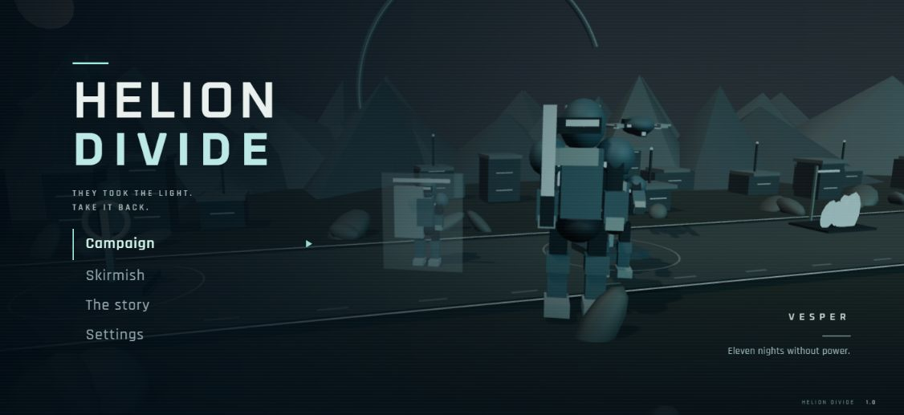
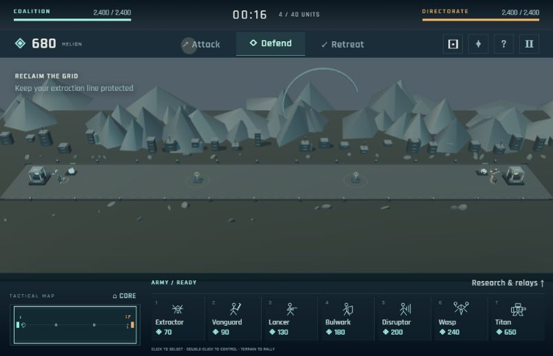

# MEINGAME

### HELION DIVIDE — reclaim the light

A single-player 3D army strategy game built with **TypeScript, Three.js, and Vite**. Gather Helion, recruit a futuristic army, command the battlefield, or take direct control of an individual soldier.



[Setup](#running-locally) · [Controls](#controls) · [Architecture](#design-and-architecture) · [Test evidence](VALIDATION.md) · [Hosted game](https://helion-divide.sharpemu67.chatgpt.site/)

**Hosted access:** the current deployment is owner-private and requires authorized sign-in. This GitHub repository is public; anyone can run the game locally with the instructions below.

## The game

Humanity depends on the Helion Grid, a planetary energy network. When the Central Directorate cuts power to frontier settlements, engineers form the Coalition and restart an abandoned extractor. The Directorate calls it theft. The Coalition calls it survival.

MEINGAME is the repository name; **HELION DIVIDE** is the game's title. The project brings the resource gathering, recruitment, and battlefield commands of side-view army strategy into an original futuristic 3D setting.

- Five campaign missions with briefings, objectives, tutorial prompts, endings, and sequential unlocks.
- Replayable AI skirmishes on three battlefield presets with Easy, Normal, and Hard difficulty.
- Seven unit roles, directional shields, EMP, anti-air combat, research, capturable relays, and forward deployment.
- Attack, Defend, and Retreat commands alongside direct keyboard control of friendly units.
- Cinematic menus and story captions, procedural articulated models, synthesized audio, graphics presets, and reduced-motion options.
- Browser-local progress between missions; no game backend or account system.

| Unit | Role |
| --- | --- |
| Extractor | Collects and delivers Helion |
| Vanguard | Fast plasma-blade infantry with a continuous charge |
| Lancer | Ranged infantry that can engage aircraft |
| Bulwark | Frontline protection with a directional shield |
| Disruptor | EMP support that temporarily disables shields |
| Wasp | Flying combat drone |
| Titan | Heavy siege mech with ground splash damage |

## Play

The first visit opens the skippable prologue. Choose **Campaign** for five sequential operations, or **Skirmish** for the complete roster on three battlefield presets. Both modes run entirely in the browser; the AI is local. The title and chapter screens use minimal cinematic menus, a connected chapter path, letterboxed story captions, and a short fade into battle.

Battles span a 192-metre field, with cores 180 metres apart and 20 metres of traversable depth. Scroll along the front with the screen edges, arrow keys, right-dragging, or the clickable tactical map. A compact command deck keeps the fighting area visible.

Extractors automatically haul Helion to the main core. Recruit troops, protect the supply line, and destroy the enemy command core. Campaign missions add relay and forward-base objectives. Ground soldiers capture a relay after six uncontested seconds nearby; captured relays produce three Helion per second. A forward base costs 350 Helion and becomes a combat-unit deployment point. Workers always deploy at the main core. The army limit is 40 units per side, including queued production. Cancel queued production for an 80% refund.

## Controls

| Input | Action |
| --- | --- |
| Click friendly unit | Select and inspect |
| Double-click unit / Enter after selection | Take or release direct control |
| WASD | Move controlled unit across the battlefield |
| Hold Space | Fire primary weapon; manually extract near a deposit |
| Q | Controlled unit's special action |
| Escape | Release direct control, then pause |
| Click ground | Set the army's defensive rally point |
| F | Cycle friendly units; transfer possession when directly controlling |
| Left/right arrows / screen edges | Pan the camera |
| Right mouse drag | Drag the camera across the field |
| Tactical map click / drag | Move the camera to a location |
| Home / End | View your core / enemy core |
| Mouse wheel | Zoom |
| Overview button (⊡) | Frame the battlefield |
| 1–7 | Recruit roster slot |
| P | Pause |

Automatic army orders are Attack, Defend, and Retreat. Defend engages threats encountered en route and enemies near its rally point. Ground clicks preserve both position and depth for flanking. Vanguards wind up and charge continuously, stopping at their first ground target instead of instantly jumping through it. Uncontrolled troops continue acting while you control a soldier. Special actions also have a button in the unit panel. Extractors in direct control must move near their deposit and hold Space to gather, then return to the main core to deliver.

## Running locally

Requires **Node.js 22.12+**, npm, and a desktop browser with WebGL 2 / hardware acceleration.

```sh
git clone https://github.com/Logesh-vr/MEINGAME.git
cd MEINGAME
npm ci
npm run dev
```

Open the URL printed by Vite. For a production build:

```sh
npm test
npm run build
npm run preview
```

`npm run build` creates `dist/`, a static site that can be served by a static host. Generated builds and dependencies are intentionally excluded from Git; the lockfile is included for reproducible installation. The production game makes no API calls and uses no accounts, remote font requests, paid assets, or remote asset downloads. The Sites hosting layer controls access to the private deployed link. `.openai/hosting.json` retains the existing Site identity; reuse it for updates.

## Design and architecture

```text
src/
  simulation.ts       Fixed-step economy, movement, combat and AI
  render.ts           Three.js scene, models, animation and camera
  main.ts             Menus, HUD, input and battle lifecycle
  data.ts             Unit statistics, missions and battlefield geometry
  save.ts             Validated browser-local progress and settings
  audio.ts            Synthesized ambience and sound effects
  style.css           Base interface styles
  cinematic.css       Title, story and chapter presentation
  battle.css          Compact battle HUD and tactical map
public/licenses/      Bundled font license notices
tests/                Simulation regressions, playthroughs and browser harnesses
docs/images/          Actual game screenshots
VALIDATION.md         Detailed checks, performance and verification limits
```


- **Simulation:** `src/simulation.ts` runs at 30 fixed steps per second. Economy, queues, research, directional shields, EMP, air targeting, projectiles, splash, capture, forward deployment, objectives, and AI are independent of Three.js.
- **Content:** `src/data.ts` defines the seven unit roles, three research upgrades, five campaign operations, original prologue, and five environment themes.
- **Rendering:** `src/render.ts` uses Three.js/WebGL 2, shared geometry/materials, instanced animated army parts, pooled effects and projectile meshes, fog, shadows, procedural architecture, and articulated figures. Rendering interpolates fixed simulation positions, turns smoothly, and drives walking from distance travelled with knee articulation and weapon recoil. CPU separation handles collisions without a general physics engine.
- **Presentation:** `src/main.ts` connects keyboard/pointer input, menus, recruitment, research, selection, and mission endings. The DOM interface updates independently of the rendering loop. `src/audio.ts` creates the original synth ambience and effects after user interaction.
- **Progress:** `src/save.ts` validates and stores mission completion, prologue status, and settings in `localStorage`. There is no active-match save. Corrupt data resets safely; storage denial reports that progress is temporary.

Both factions pay the same unit prices and use the same extraction rules, starting resources, and roster. Difficulty changes economic planning, decision intervals, composition, and aggression. Campaign enemies additionally have visible starting defenses appropriate to the mission.

The artwork deliberately uses stylized geometry with a restrained graphite/cyan/amber palette rather than photorealistic assets. Full cutscene voice acting and prerecorded cinematics are outside this build; the story uses the live 3D scene, animated camera, captions, and ambience.

## Verification and limits

**53 automated tests** cover the economy, production limits, air targeting, directional shielding, EMP recovery, upgrades, captures, forward bases, mission outcomes, saves, control transitions, and movement regressions. Command-driven tests complete all five campaign missions on Easy and reach outcomes at every skirmish difficulty.

The 80-unit live-simulation benchmark recorded **60.1 FPS on Medium** at **803 × 517**, render scale 1.25, on an NVIDIA GeForce RTX 3050 A Laptop GPU through ANGLE / Direct3D 11. It excludes the normal HUD and audio and uses inflated hull values to hold the sample at capacity. It is a measured test case, not a guarantee for every machine.



See [VALIDATION.md](VALIDATION.md) for test evidence and measured rendering performance. Automated campaign completion is a simulation test; it is distinct from a human playthrough. Browser checks verify representative UI and rendering flows separately.

Desktop keyboard/mouse and WebGL 2 are required for the intended experience. Narrow-screen styles are included, but mobile touch gameplay, multiplayer, accounts, purchases, active-match saves, and cloud progress synchronization are not implemented. The browser pauses the match when focus is lost. Audio requires an initial click/key interaction, and actual speaker/headphone listening is a separate physical check.

The development-only 80-unit rendering harness is available at `/tests/benchmark.html` while the Vite server is running; it is not included in `dist/`. It measures fully populated animated armies and scenery without an active combat simulation. The additional `/tests/battle-benchmark.html` harness runs the full simulation with 80 units, projectiles, and effects. It uses inflated hulls to hold the sample at capacity and excludes the game HUD and sound. Both harnesses are development-only; neither is published.

## Original work and dependencies

The setting, campaign writing, meshes, icons, interface, and synthesized sound are original to this project. Gameplay takes inspiration from side-view army strategy games; no Stick War artwork, names, music, maps, or code are included. [Three.js](https://threejs.org/) and [Vite](https://vite.dev/) provide the rendering library and build tooling; their licenses remain in their packages.

Oxanium and Rajdhani are bundled locally through Fontsource. Their SIL Open Font License notices are included in `public/licenses/` and copied into the deployed build.
